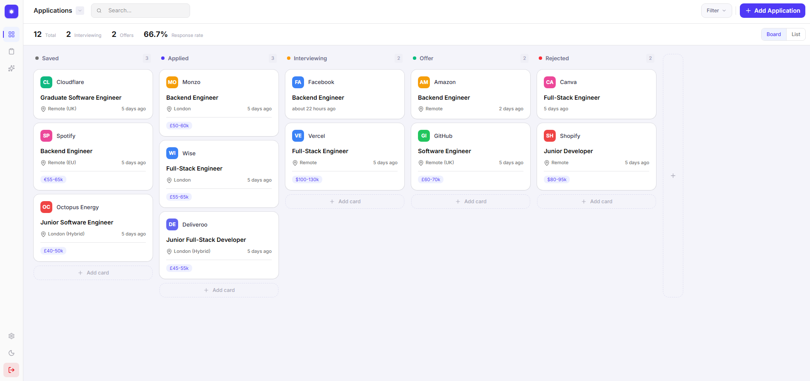
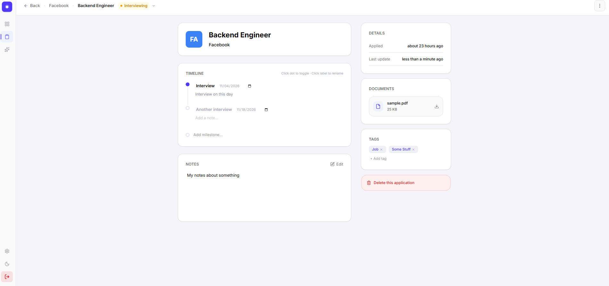
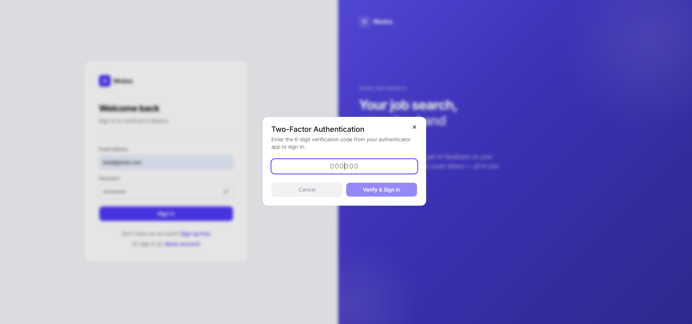

# Modus

A full-stack job application tracker with a drag-and-drop Kanban board, CV management, and AI-assisted CV feedback, backed by a separate Express API with production-style authentication.

**Live demo:** https://modus-gilt.vercel.app/
**Repo:** https://github.com/Koraxdd/modus

> Try it instantly with the **Demo Login** button on the landing page, no signup required. The API runs on a free tier, so the first request after a quiet period can take up to a minute while it wakes up.

---

## TL;DR

Modus lets you track applications across a Kanban board and list view, keep a timeline, tags and notes per job, upload CVs, score a CV against a job description, and get suggested bullet-point rewrites. The backend is a standalone Express API with JWT auth (access and refresh tokens), TOTP two-factor authentication, rate limiting, and an integration test suite that runs in CI.

**Core stack:** Next.js (App Router) · TypeScript · Express · Prisma · PostgreSQL · TanStack Query · Zustand · Tailwind CSS · Gemini API · Cloudinary

**Highlights:**

- Drag-and-drop Kanban board with optimistic status updates
- Access token held in memory, refresh token in an httpOnly cookie, with silent refresh and retry
- TOTP 2FA with QR enrollment and layered rate limiting (per IP and per account)
- CV upload with server-side text extraction; AI endpoints read the text from the database
- Match scoring and rewrite suggestions with schema-validated model output, retries and model fallback
- Vitest and Supertest tests against an isolated database, with GitHub Actions CI

---

## Features

### Applications

- Kanban board (Saved, Applied, Interviewing, Offer, Rejected) with drag-and-drop between columns
- List view with search, status pills with live counts, and a filter panel (status, location, salary)
- Detail page per application: editable timeline milestones (inline edit, toggle, dates), tags, notes, colour, and a link to the posting

### CV Manager

- PDF upload (5 MB limit) stored in Cloudinary, with text extracted once at upload and saved to the database
- In-page preview and delete, which removes both the database row and the stored file

### AI tools

- **Match score:** pick a CV, paste a job description, and get an overall score plus keyword, formatting and impact breakdowns with itemised feedback
- **Enhance:** suggested rewrites of weak bullets as before/after cards with a short reason, with placeholders instead of invented metrics

### Account

- Registration, login, onboarding flow
- Profile, avatar upload, change password
- TOTP two-factor authentication
- Account deletion that also removes stored files

---

## Tech Stack

| Layer         | Choice                                                       |
| ------------- | ------------------------------------------------------------ |
| Frontend      | Next.js 16 (App Router), TypeScript, Tailwind CSS, shadcn/ui |
| Client state  | TanStack Query (server state), Zustand (auth token, UI)      |
| Forms         | React Hook Form + Zod                                        |
| Drag and drop | @dnd-kit/react                                               |
| API           | Node.js, Express, TypeScript                                 |
| Database      | PostgreSQL, Prisma                                           |
| Auth          | JWT (access and refresh), Argon2, otplib + qrcode for TOTP   |
| Security      | express-rate-limit, Helmet, Zod request validation           |
| Files         | Multer, Cloudinary, unpdf for text extraction                |
| AI            | Google Gemini API                                            |
| Testing       | Vitest, Supertest, React Testing Library, GitHub Actions     |
| Hosting       | Vercel (web), Render (API), Neon (database)                  |

---

## Getting Started

### Prerequisites

- Node.js 20+
- A PostgreSQL database
- Accounts and keys for [Cloudinary](https://cloudinary.com) and the [Gemini API](https://ai.google.dev)

### Setup

```bash
git clone [REPO_URL]
cd modus

# API
cd backend
npm install
```

Create `backend/.env`:

```env
DATABASE_URL=
JWT_ACCESS_SECRET=
JWT_REFRESH_SECRET=
API_URL=http://localhost:5000
CLIENT_URL=http://localhost:3000
CLOUDINARY_CLOUD_NAME=
CLOUDINARY_API_KEY=
CLOUDINARY_API_SECRET=
GEMINI_API_KEY=
```

```bash
npx prisma migrate dev
npm run dev
```

In a second terminal:

```bash
cd web
npm install
```

Create `web/.env.local`:

```env
NEXT_PUBLIC_API_URL=http://localhost:5000
```

```bash
npm run dev
```

### Tests

```bash
cd backend && npm test
cd web && npm test
```

Backend tests need a separate database (set its URL in `backend/.env.test`).

---

## Architecture Notes & Decisions

- **Token storage.** The access token lives in memory (Zustand) and is attached by a single fetch wrapper that, on a 401, calls the refresh endpoint and retries once. The refresh token is an httpOnly cookie, so scripts can't read it. The trade-off is that authenticated pages are client-rendered, because server components can't see an in-memory token. `proxy.ts` only checks that a refresh cookie exists, and real verification happens in the API's `requireAuth` middleware.
- **Same-origin API in production.** The frontend and API are on different hosts, which would make the refresh cookie a third-party cookie that Safari and private windows block. The web app proxies `/api/*` to the API with a Next.js rewrite, so the cookie stays first-party.
- **Layered API.** Each module is route, controller, service, repository. Controllers only translate HTTP, services hold the rules and throw typed errors, repositories hold the Prisma calls. A central error handler turns those errors into one JSON shape.
- **CV text is extracted once.** Text is pulled at upload and stored, so AI features never re-parse files. The client sends a document id, not CV text, and the API looks the text up and checks that the document belongs to the caller.
- **Rate limiting by risk.** Login is limited per IP and per email, AI routes are limited per user with a loose IP backstop and a shared daily cap (they spend one quota), and password-guessing routes count only failed attempts.
- **2FA login.** Login is one route with an optional code. It reports that a code is needed only after the password has verified, so it doesn't reveal which accounts have 2FA. A user's 2FA is switched on only after they enter a valid first code.
- **Testing.** Routes are tested through Supertest against a real, isolated Postgres database. External services (Cloudinary, Gemini) are mocked, so tests are fast and never spend quota.

## Known Limitations

- **Cold starts.** The API runs on a free tier that sleeps when idle, so the first request after a quiet period is slow.
- **No email.** Sending email needs a verified domain, so there's no email verification or forgot-password flow.
- **Sessions are stateless.** Existing refresh tokens stay valid until they expire (14 days), including after a password change or account deletion.
- **Match score is an estimate.** It's a language model's judgement of keyword and impact fit, not output from a real applicant tracking system.
- **PDF only, text-based.** Scanned PDFs have no extractable text (no OCR) and are rejected. The free AI tier can return "busy" errors during peak demand.
- **Rate limiter is in memory.** Counters reset on restart and aren't shared across instances.
- **Not included:** OAuth sign-in, payments

---

## Screenshots

**Kanban board**

<p align="center">  </p>

**Application detail**

<p align="center">  </p>

**Match report**

<p align="center">  </p>

**Enhance CV**

<p align="center">  </p>

**2FA**

<p align="center">  </p>
